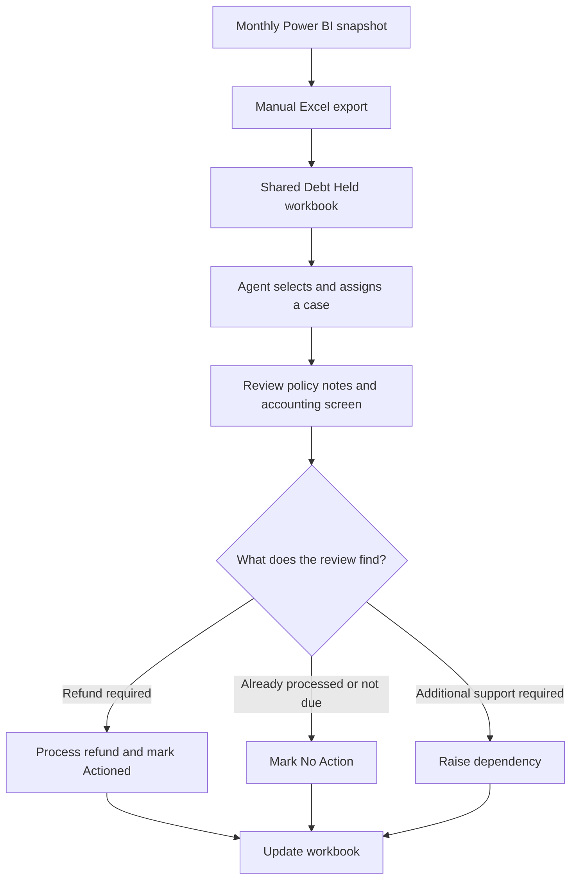

# Current Business Process

## Purpose

This document describes the existing manual Debt Held process that inspired the synthetic portfolio project.

The process identifies accounting differences that may represent outstanding customer refunds. The source report identifies the difference but does not explain the cancellation reason, why the refund was missed or the final outcome of the investigation.

No real customer, employee or company data is included in this repository.

## Current-State Workflow

## Detailed Operational Workflow

1. A monthly Power BI snapshot identifies policies with an accounting difference requiring investigation.
2. The snapshot is manually exported and added to the existing shared Excel workbook.
3. A trained agent selects a case and assigns it to themselves.
4. The agent copies the policy number into the customer management system.
5. The agent reviews the policy notes and history.
6. The agent checks the accounting screen to determine whether a refund has already been processed.
7. The agent decides whether a refund remains due.
8. If a refund is required, the agent processes it and records the case as `Actioned`.
9. If the refund has already been processed or no refund is due, the agent records `No Action`.
10. If senior review or another department is required, the case is raised for additional action.
11. Cases are normally assigned and completed during the same working session. If an agent cannot continue, they remove their assignment so another trained agent can select the case.
12. The workbook is manually updated to record the result.

## Information Available from the Source Report

The source discrepancy report can reasonably provide:

- Case identifier
- Policy number
- Client number
- Snapshot date
- Outstanding amount
- Cancellation status
- Cancelling department
- Cancelling agent

It does not directly provide:

- Cancellation or refund type
- Root cause of the missed refund
- Customer-contact history
- Final investigation outcome
- Agent notes
- Whether a refund was processed after the snapshot

Refund transaction information is available separately from the accounting screen. Outcomes and explanatory information are determined during agent review.

## Current Pain Points

- The monthly snapshot may already be several weeks old when work begins.
- The export and workbook import depend on manual intervention.
- Cases may have been resolved after the snapshot but still appear in the workbook.
- Agents must manually check the accounting screen for every case.
- Existing assignments, notes and outcomes could be placed at risk by an unsafe refresh.
- The broad `No Action` result combines refunds already processed with cases where no refund was due.
- Root causes and investigation reasons are not captured consistently in structured fields.
- Backlogs can develop when limited processing time is available.
- The workbook provides limited audit history and workflow controls.
- Management reporting depends on manual updates remaining complete and accurate.

## Improvement Opportunity

A future workflow should preserve operational records across monthly refreshes, automatically identify reliable processed-refund matches, retain human review for exceptions and provide separate agent and management interfaces connected to the same reporting data.