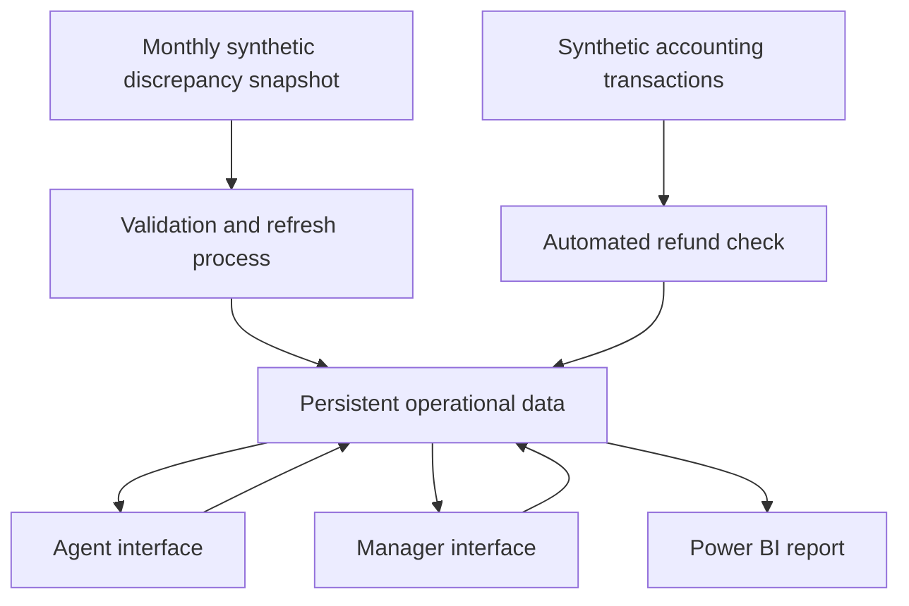

# Improved Workflow Prototype

## Purpose

This document defines the proposed future-state missed-refund workflow, its technical boundaries and the criteria used to determine whether the prototype is successful.

The design builds on the existing Streamlit and SQLite proof of concept. A future Power Platform implementation will reproduce and extend the proven workflow using Power Apps, Power Automate and, where access permits, Dataverse.

All data used by the prototype is synthetic.

## Improvement Objective

The prototype demonstrates how the existing static report and shared Excel process could be replaced by a controlled workflow that:

- preserves operational records across monthly refreshes
- reduces unnecessary manual accounting checks
- separates source information from agent-maintained information
- automatically completes only reliable refund matches
- retains human review for exceptions
- provides role-specific agent and management interfaces
- records workflow and automation history
- supplies consistent data to Power BI

## Future-State Architecture

The monthly snapshot remains a source input. It does not become the operational record and cannot overwrite agent activity, completion information or audit history.

## Data Responsibilities

| Data object | Purpose | Refresh behaviour |
|---|---|---|
| Source Cases | Stores case information supplied by the monthly discrepancy snapshot | Valid source fields may be refreshed |
| Agent Updates | Stores assignment, notes, status, outcome and completion information | Persistent and protected from source refreshes |
| Refund Transactions | Simulates the accounting information currently checked manually | New extracts can be loaded and validated |
| Current Automation Results | Stores the latest case-level matching decision | Rebuilt for the current automation run |
| Automation History | Retains case-level results by Automation Run ID | Historical runs are retained without duplicate run-and-case combinations |
| Workflow Events | Records assignment, notes, dependencies and completion actions | Append-only during normal workflow use |
| Refresh Log | Records file, date, accepted rows, rejected rows and refresh outcome | One record per refresh attempt |
| Data-Quality Exceptions | Stores rejected or unreliable source records | Retained until reviewed or resolved |

## Source-System Boundaries

The monthly discrepancy report can provide:

- Case ID
- Policy number
- Client number
- Snapshot date
- Outstanding amount
- Cancellation status
- Cancelling department
- Cancelling agent

The source report does not directly provide:

- refund or cancellation reason
- root cause of the missed refund
- customer-contact history
- final investigation outcome
- agent notes
- refund activity occurring after the snapshot

Refund transaction information comes from the separate accounting extract. Outcomes and explanatory information are recorded through the operational workflow.

The analytical dataset may retain deliberately generated enrichment such as `Refund Type`, `Root Cause` and `Customer Contacted`. These fields support portfolio analysis but are not presented as fields supplied by the real discrepancy report.

## Refresh-Safe Processing

When a new monthly snapshot is received, the process should:

1. Validate required columns and data types.
2. identify duplicate or missing Case IDs.
3. quarantine invalid records rather than loading them silently.
4. add genuinely new cases.
5. update only permitted source-controlled fields.
6. create a default operational record for each new Case ID.
7. preserve all existing assignments, notes, statuses and outcomes.
8. preserve manual and automated completions.
9. record accepted, updated and rejected row counts.
10. refresh the operational reporting view.

The process must not replace the persistent operational table with the newest spreadsheet.

## Automated Accounting Check

The automated check compares eligible cases with the accounting extract using:

- Policy Number
- Client Number
- Outstanding Amount
- Snapshot Date
- Refund Processed Date
- Number of valid matching transactions

A case can be completed automatically only when:

- it has not already been completed manually
- policy and client identifiers match
- the refund amount equals the outstanding amount
- the refund was processed after the case snapshot
- the refund was processed on or before the accounting extract date
- exactly one valid transaction matches the case

Possible results are:

- `Confirmed Unique Match`
- `Amount Mismatch`
- `Refund Not After Snapshot`
- `Multiple Valid Matches`
- `No Accounting Transaction`

Only `Confirmed Unique Match` results can become automated completions. All other results remain available for human review.

Rerunning the same automation run must not create duplicate completions or duplicate history records.

## Agent Interface

The agent-facing interface should allow an authorised simulated agent to:

- view available unassigned cases
- view cases assigned to them
- search by case, policy or client identifier
- filter by automated-check result
- assign an available case to themselves
- view the genuine source case fields
- view relevant accounting-check information
- enter investigation notes
- record a structured investigation reason when it can be determined
- refer a case for senior review or another department
- select a controlled final outcome
- complete a case
- remove their assignment if they cannot continue
- view completed work as read-only

An agent must not be able to overwrite a completed case or a newer update made by another user.

## Manager Interface

The manager-facing interface should support:

- current backlog monitoring
- assigned and unassigned workload
- agent workload comparison
- case reassignment where authorised
- dependency monitoring
- overdue dependency identification
- ambiguous accounting-match review
- data-quality exception review
- refresh-history review
- automation-run review
- completed-case reporting
- workflow-event history
- authorised corrections where appropriate

The manager interface supports operational actions. Power BI remains the primary tool for trends, performance measures and management analysis.

## Power BI Reporting

The planned operational Power BI report should use the same controlled data as the applications.

It should report:

- current backlog and outstanding value
- case ageing
- assigned and unassigned work
- manual and automated completions
- estimated manual time saved
- dependencies and overdue actions
- ambiguous accounting matches
- data-quality exceptions
- refresh results
- automation-run history
- agent-captured investigation reasons

Agent-captured reasons must be clearly labelled. They must not be described as fields extracted from the original discrepancy report.

## Current and Planned Implementations

### Current Proof of Concept

The current Streamlit implementation uses SQLite and demonstrates:

- separate operational and agent interfaces
- shared case queues
- conditional assignment
- dependency handling
- controlled completion
- workflow-event history
- protection against conflicting updates

It simulates authentication through agent selection and is not intended as a production application.

### Planned Power Platform Prototype

The planned Power Platform version will use:

- Power Apps for the role-specific interfaces
- Power Automate for representative workflow and audit actions
- Dataverse as the preferred backend when a suitable development environment is available
- SharePoint Lists only as a fallback proof-of-concept backend
- Power BI for operational and management reporting

The Power Platform environment will be activated only after the data model, screen designs and test cases are prepared, so a time-limited development environment can be used efficiently.

## Prototype Boundaries

The prototype will not:

- connect to a real customer platform
- use genuine customer, employee or company information
- process real refunds
- recreate the full customer-management or accounting system
- infer a root cause automatically
- automatically resolve ambiguous matches
- implement production authentication
- claim production readiness
- use AI where deterministic rules and human review are more appropriate

The prototype demonstrates workflow and control design rather than a production deployment.

## Success Criteria

The prototype will be considered successful when it proves that:

1. Every valid source Case ID has one operational record.
2. Duplicate source Case IDs are rejected or quarantined.
3. A new monthly snapshot adds new cases without duplicating existing cases.
4. Permitted source changes are updated without overwriting operational activity.
5. Manual completions survive later source refreshes.
6. Automated completions survive later source refreshes.
7. Agent assignments and notes survive later source refreshes.
8. Rerunning automation creates no duplicate completions.
9. Rerunning the same Automation Run ID creates no duplicate history records.
10. Ambiguous, mismatched and pre-snapshot transactions remain with a human.
11. Completed cases are read-only in the agent interface.
12. Conflicting assignments are prevented.
13. Dependency actions are recorded in workflow history.
14. Invalid source records are visible through a data-quality exception process.
15. Agent and manager interfaces use the same current operational data.
16. Power BI reconciles with the application’s case totals.
17. Agent-captured investigation reasons are distinguished from source-system information.
18. No real or confidential information is used.

## Portfolio Evidence

The finished prototype should be demonstrated through:

- screenshots of both role-specific interfaces
- a short screen recording
- current-state and future-state workflow diagrams
- the data model and data dictionary
- documented matching and refresh rules
- refresh-safety test results
- automation-history evidence
- Power BI screenshots
- limitations and production considerations

This evidence will allow recruiters to assess the project without requiring access to the development environment.
